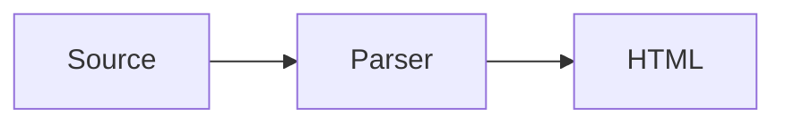

# MDS :: markdown-sucks

**Origin tags**

| tag | meaning |
|---|---|
| `CM` | [CommonMark 0.31.2](https://spec.commonmark.org/0.31.2/), the core every modern parser implements |
| `GFM` | [GitHub Flavored Markdown 0.29](https://github.github.com/gfm/), a strict superset of CommonMark |
| `GH` | GitHub only, not part of the GFM spec |
| `ext` | a common extension, with the tools that support it |

---

## Contents

1. [Document model](#1-document-model)
2. [Paragraphs and line breaks](#2-paragraphs-and-line-breaks)
3. [Headings](#3-headings)
4. [Thematic break](#4-thematic-break)
5. [Block quotes](#5-block-quotes)
6. [Lists](#6-lists)
7. [Code blocks](#7-code-blocks)
8. [HTML blocks](#8-html-blocks)
9. [Emphasis](#9-emphasis)
10. [Code spans](#10-code-spans)
11. [Links](#11-links)
12. [Images](#12-images)
13. [Autolinks](#13-autolinks)
14. [Inline HTML](#14-inline-html)
15. [Escapes and entities](#15-escapes-and-entities)
16. [Tables](#16-tables)
17. [Task lists](#17-task-lists)
18. [Strikethrough](#18-strikethrough)
19. [Footnotes](#19-footnotes)
20. [Alerts](#20-alerts)
21. [GitHub references](#21-github-references)
22. [Front matter](#22-front-matter)
23. [Attributes and heading ids](#23-attributes-and-heading-ids)
24. [Definition lists](#24-definition-lists)
25. [Abbreviations](#25-abbreviations)
26. [Math](#26-math)
27. [Inline formatting extras](#27-inline-formatting-extras)
28. [Emoji](#28-emoji)
29. [Containers and admonitions](#29-containers-and-admonitions)
30. [Directives](#30-directives)
31. [Wikilinks and embeds](#31-wikilinks-and-embeds)
32. [Table of contents](#32-table-of-contents)
33. [Citations](#33-citations)
34. [Comments](#34-comments)
35. [Diagrams](#35-diagrams)
36. [Typographer](#36-typographer)
37. [MDX](#37-mdx)
38. [Quirks](#38-quirks)

---

## 1. Document model

`CM`

- A document is a sequence of **blocks**. Blocks contain **inlines** (text, emphasis, links, code spans …) or other blocks.
- **Container blocks** hold blocks: block quotes, list items. **Leaf blocks** hold inlines or raw text: paragraphs, headings, code blocks, HTML blocks, thematic breaks, link reference definitions.
- Blocks are parsed first, inlines second. Inline syntax never spans two blocks.
- A **blank line** is a line with only spaces or tabs. It ends paragraphs and separates most blocks.
- Up to **3 spaces** of indentation are ignored for most blocks. **4 spaces** (or a tab) start an indented code block, unless inside a list item where indentation is relative to the item content.
- A tab counts as advancing to the next multiple of 4 columns.
- Line endings: `\n`, `\r\n` or `\r`.

---

## 2. Paragraphs and line breaks

`CM`

```md
A paragraph is one or more lines of text.
These two lines form one paragraph.

A blank line starts a new one.
```

**Soft break:** a single line ending inside a paragraph. Rendered as a space (or a newline in the HTML source, which the browser shows as a space).

**Hard break:** forces a `<br>`.

```md
two or more trailing spaces··
then the next line

a backslash at the end\
then the next line
```

A hard break at the very end of a block is ignored.

---

## 3. Headings

`CM`

**ATX:** 1 to 6 `#`, then at least one space.

```md
# h1
## h2
###### h6

## closing hashes are optional ##
#no space: not a heading
```

**Setext:** a line of text underlined with `=` (h1) or `-` (h2), any length.

```md
Heading 1
=========

Heading 2
---------
```

- Setext headings can span several lines of text; ATX headings cannot.
- An empty ATX heading (`#`) is allowed.
- Heading ids are not part of CommonMark; see [23](#23-attributes-and-heading-ids).

```md
# h1
## h2
###### h6

## closing hashes are optional ##
#no space: not a heading

## multiple
lines ##

## multiple
## lines
```

---

## 4. Thematic break

`CM`

Three or more `*`, `-` or `_` on a line, spaces allowed between them. Renders `<hr>`.

```md
***
---
_ _ _
```

`---` directly under a paragraph line is a setext heading, not a break.

---

## 5. Block quotes

`CM`

```md
> A quote.
> Still the same paragraph.
>
> A second paragraph.

> Nested:
>> inner quote

> Any block works inside:
> - a list
> ```js
> code
> ```
```

**Lazy continuation:** a paragraph inside a quote continues on lines without `>`.

```md
> This line
and this line are one quoted paragraph.
```

---

## 6. Lists

`CM`

### Bullet lists

Marker `-`, `+` or `*`, then 1 to 4 spaces.

```md
- one
- two
- three
```

Changing the marker starts a **new list**:

```md
- a
- b
+ c        ← a second list
```

### Ordered lists

1 to 9 digits, then `.` or `)`. Only the **first** number counts: it sets `start`.

```md
1. one
1. two
1. three

3) starts at three
4) four
```

### Nesting and content

The content of an item starts at the column after the marker and its spaces. Continuation lines and nested blocks are indented to that column.

````md
1. First item.

   A second paragraph in the same item.

   - nested list
   - nested list

   ```js
   code in the item
   ```

2. Second item.
````

### Tight and loose

- **Tight:** no blank lines between items. Items render without `<p>`.
- **Loose:** a blank line between any two items, or between blocks inside an item. All items render with `<p>`.

### Interrupting a paragraph

A bullet list can interrupt a paragraph. An ordered list can only if it starts with `1`.

```md
The year was
1986. Not a list.

Steps:
1. a list
```

---

## 7. Code blocks

`CM`

### Fenced

At least 3 backticks or tildes. The closing fence uses the same character, at least as many.

````md
```js
const a = 1;
```

~~~
tildes work too
~~~
````

- The text after the opening fence is the **info string**. Its first word is the language (`class="language-js"`). The rest is free for tools: `` ```js title="a.js" {1,3} ``.
- A backtick fence's info string must not contain backticks.
- To show a fence inside a fence, use a longer fence outside:

`````md
````md
```js
nested
```
````
`````

- An unclosed fence runs to the end of the document or container.

### Indented

Four spaces or a tab. No language.

```md
    indented code
    second line
```

An indented code block cannot interrupt a paragraph.

---

## 8. HTML blocks

`CM`

Raw HTML is passed through as is. A block starts with one of seven conditions:

| # | starts with | ends at |
|---|---|---|
| 1 | `<pre`, `<script`, `<style`, `<textarea` | the matching closing tag |
| 2 | `<!--` | `-->` |
| 3 | `<?` | `?>` |
| 4 | `<!` + letter (`<!DOCTYPE`) | `>` |
| 5 | `<![CDATA[` | `]]>` |
| 6 | a known block tag (`div`, `table`, `section`, `p`, `ul` …), open or closing | a blank line |
| 7 | any other complete open or closing tag alone on its line | a blank line (cannot interrupt a paragraph) |

```md
<div class="note">

Markdown works here **again**, because the blank line ended the HTML block.

</div>
```

Without the blank lines, the content stays raw HTML and Markdown inside is not parsed.

---

## 9. Emphasis

`CM`

```md
*em*  _em_
**strong**  __strong__
***both***  **_both_**  *__both__*
```

- `_` does not work **inside words**: `snake_case_name` stays as is. `*` does: `un*frigging*believable`.
- A delimiter run must be **left-flanking** to open and **right-flanking** to close: `* not em *` (spaces inside) is literal.
- Nesting: `*a **b** c*`, `**a *b* c**`.

---

## 10. Code spans

`CM`

```md
`code`
``code with a ` backtick``
`` `starts with a backtick` ``
```

- Delimited by equal-length backtick strings.
- If the content begins **and** ends with a space (and is not all spaces), one space is stripped on each side.
- Line endings inside become spaces.
- No escapes and no other syntax inside: `` `\*` `` shows `\*`.

---

## 11. Links

`CM`

### Inline

```md
[text](https://example.com)
[text](https://example.com "title")
[text](https://example.com 'title')
[text](https://example.com (title))
[text](<url with spaces.html>)
[text](#heading-id)
[text](./relative/file.md)
[](empty text is allowed)
```

### Reference

```md
[full reference][label]
[collapsed][]
[shortcut]

[label]: https://example.com "optional title"
[collapsed]: https://example.com
[shortcut]: <https://example.com/with space>
```

- Labels are **case-insensitive** and whitespace-normalized: `[Foo Bar]` matches `[foo   bar]`.
- The first definition of a label wins.
- Definitions render nothing and may sit anywhere at block level.
- Link text may contain inlines, but **no other links**.

---

## 12. Images

`CM`

Same as links, with `!` in front. The text becomes the `alt` attribute (inline markup is flattened to plain text).

```md


![alt text][logo]

[logo]: ./logo.svg

[](full.png)
```

No syntax for size, alignment or captions in CommonMark. See [23](#23-attributes-and-heading-ids) and [14](#14-inline-html).

---

## 13. Autolinks

`CM`

```md
<https://example.com>
<mailto:mail@example.com>
<mail@example.com>
```

Any scheme of 2 to 32 characters works: `<irc://host>`, `<ftp://x>`.

**Extended autolinks** `GFM`: without angle brackets.

```md
www.example.com
https://example.com/path?q=1
mail@example.com
```

Trailing punctuation (`.`, `,`, `)` when unbalanced) is not part of the link.

---

## 14. Inline HTML

`CM`

```md
Press <kbd>Ctrl</kbd> + <kbd>C</kbd>.
H<sub>2</sub>O, x<sup>2</sup>, <mark>marked</mark>, <ins>inserted</ins>

<details><summary>more</summary>hidden</details>
```

Any open tag, closing tag, comment, processing instruction, declaration or CDATA is passed through.

**Disallowed raw HTML** `GFM`: `<title>`, `<textarea>`, `<style>`, `<xmp>`, `<iframe>`, `<noembed>`, `<noframes>`, `<script>`, `<plaintext>` are escaped (`<` → `&lt;`). GitHub additionally sanitizes most attributes.

---

## 15. Escapes and entities

`CM`

A backslash before any **ASCII punctuation** character makes it literal:

```md
\*not em\*  \# not a heading  \[not a link\]  1\. not a list
```

Escapable: `` ! " # $ % & ' ( ) * + , - . / : ; < = > ? @ [ \ ] ^ _ ` { | } ~ ``

A backslash before anything else is a literal backslash. Escapes do not work in code spans, code blocks, autolinks or raw HTML.

**Entities:** named, decimal or hexadecimal, valid everywhere except code.

```md
&copy; &nbsp; &mdash; &#169; &#xA9;
```

---

## 16. Tables

`GFM`

```md
| Name   | Size | Price |
|:-------|:----:|------:|
| Apple  |  S   |  1.20 |
| Melon  |  L   |  3.50 |
```

- A header row, a **delimiter row**, then body rows.
- Delimiter cells: one or more `-`. `:` on the left aligns left, on the right aligns right, on both centers.
- Leading and trailing pipes are optional; cells need not line up.
- The header and the delimiter row must have the same number of cells. Body rows with fewer cells are filled, extra cells are dropped.
- Cells hold **inlines only**: no lists, no code blocks, no line breaks (use `<br>`).
- A literal pipe in a cell: `\|`, also inside code spans.
- The table ends at a blank line or the start of another block.

---

## 17. Task lists

`GFM`

```md
- [ ] open
- [x] done
- [X] done too
  - [ ] nested
```

Renders disabled checkboxes. On GitHub, they can be toggled in issues and pull requests.

---

## 18. Strikethrough

`GFM`

```md
~~struck~~
~struck~       ← one tilde works too in GFM
```

Three or more tildes are not strikethrough.

---

## 19. Footnotes

`GH` · `ext` (Pandoc, markdown-it-footnote, PHP Markdown Extra, MultiMarkdown, Obsidian)

```md
A claim.[^1] Another one.[^note]

[^1]: The footnote text.
[^note]: Footnotes can have
    several paragraphs, indented by 4 spaces.

    Like this one.
```

- Labels are any text without spaces; they are renumbered in order of reference.
- Rendered as a numbered list at the end of the document, with back links.
- **Inline footnotes** `ext` (Pandoc, markdown-it): `text^[the note right here]`.

---

## 20. Alerts

`GH` · `ext` (Obsidian callouts, markdown-it-github-alerts)

```md
> [!NOTE]
> Useful information.

> [!TIP]
> A better way.

> [!IMPORTANT]
> Must know.

> [!WARNING]
> Needs attention.

> [!CAUTION]
> Risk of negative outcomes.
```

**Obsidian callouts** extend this: any type, a custom title, and folding.

```md
> [!question]- Folded by default, with a title
> Content.
```

---

## 21. GitHub references

`GH`, only inside GitHub (issues, PRs, comments, repository files partly)

```md
@user  @org/team
#123  owner/repo#123  GH-123
a5c3785ed8d6a35868bc169f07e40e889087fd2e   (commit sha, shortened in rendering)
owner/repo@a5c3785
```

---

## 22. Front matter

`ext` (Jekyll, Hugo, Astro, Eleventy, MDX, Obsidian, most static site generators; GitHub renders it as a table)

```md
---
title: Hello
tags: [a, b]
draft: false
---

# Content
```

- YAML between `---` lines, at the very start of the file.
- TOML between `+++` (Hugo, Zola). JSON as an object (Hugo).
- Not rendered; read by the tool.

---

## 23. Attributes and heading ids

`ext` (Pandoc, markdown-it-attrs, kramdown, PHP Markdown Extra, MyST, Python-Markdown attr_list)

```md
## Heading {#custom-id}
## Heading {#id .class key="value"}

A paragraph.
{.lead}

[link](https://example.com){target="_blank" rel="noopener"}
{width=200 .rounded}
`code`{.lang-js}
```

**Automatic heading ids** `GH` · `ext`: GitHub and most tools derive an id from the text (lowercase, spaces → `-`, punctuation dropped, duplicates get `-1`, `-2`). Not standardized; slugs differ between tools.

---

## 24. Definition lists

`ext` (PHP Markdown Extra, Pandoc, markdown-it-deflist, kramdown, MultiMarkdown, Python-Markdown)

```md
Term
: Definition.

Another term
Synonym
: First definition.
: Second definition.

    A second paragraph of the second definition.
```

Renders `<dl>`, `<dt>`, `<dd>`.

---

## 25. Abbreviations

`ext` (PHP Markdown Extra, markdown-it-abbr, Python-Markdown, MultiMarkdown)

```md
The HTML spec is maintained by the W3C.

*[HTML]: Hyper Text Markup Language
*[W3C]: World Wide Web Consortium
```

Every occurrence becomes `<abbr title="…">`.

---

## 26. Math

`GH` · `ext` (Pandoc, KaTeX and MathJax plugins, Obsidian, Jupyter, MyST)

```md
Inline: $E = mc^2$

Block:

$$
\int_0^1 x^2 \, dx = \frac{1}{3}
$$
```

Also: `` $`E = mc^2`$ `` (GitHub, safe against `$` in prose) and a fenced block with the language `math`.

```math
\sum_{i=1}^{n} i = \frac{n(n+1)}{2}
```

---

## 27. Inline formatting extras

`ext`, support varies

| syntax | result | supported by |
|---|---|---|
| `==marked==` | `<mark>` | markdown-it-mark, Obsidian, MkDocs (pymdownx), Typora |
| `++inserted++` | `<ins>` | markdown-it-ins, pymdownx |
| `~sub~` | `<sub>` | Pandoc, markdown-it-sub, pymdownx (conflicts with GFM single-tilde strikethrough) |
| `^sup^` | `<sup>` | Pandoc, markdown-it-sup, pymdownx |
| `[[Ctrl+C]]` / `++ctrl+c++` | `<kbd>` | pymdownx.keys, some wikis |
| `[text]{.underline}` | `<span>` with attributes | Pandoc bracketed spans, markdown-it-attrs |

---

## 28. Emoji

`GH` · `ext` (markdown-it-emoji, Python-Markdown, Slack, Discord)

```md
:smile: :+1: :rocket: :warning:
```

Shortcodes map to Unicode emoji or images. The list of names differs per tool.

---

## 29. Containers and admonitions

`ext`

**Fenced divs / custom containers** (Pandoc, markdown-it-container, VitePress, Docusaurus, MyST):

```md
::: warning
Careful.
:::

::: details Click to open
Hidden content.
:::

::: {.note #intro}
Pandoc fenced div with attributes.
:::
```

Nesting uses more colons outside: `::::` around `:::`.

**Python-Markdown / MkDocs admonitions:**

```md
!!! note "Optional title"
    Indented content.

??? tip "Collapsible"
    Folded by default.
```

---

## 30. Directives

`ext` ([generic directives proposal](https://talk.commonmark.org/t/generic-directives-plugins-syntax/444), remark-directive, MyST)

```md
:abbr[HTML]{title="Hyper Text Markup Language"}     ← text (inline)

::youtube[Video title]{#dQw4w9WgXcQ}                ← leaf (one line)

:::aside{.wide}                                     ← container
Content with **markdown**.
:::
```

One syntax for all custom elements: name, `[label]`, `{attributes}`. MyST uses `` ```{directive} `` fences and `` {role}`text` `` instead.

---

## 31. Wikilinks and embeds

`ext` (Obsidian, Foam, MediaWiki-inspired tools, markdown-it-wikilinks)

```md
[[Page]]
[[Page|shown text]]
[[Page#Heading]]
[[Page#^block-id]]

![[Page]]               ← embed the whole note
![[image.png|300]]      ← embed with width
```

Links by name, not by path. The tool resolves the file.

---

## 32. Table of contents

`ext`, no common syntax

```md
[[toc]]       markdown-it-toc-done-right, VitePress
[TOC]         Python-Markdown, MultiMarkdown
${toc}        markdown-it-toc
```

GitHub generates a TOC in the file view, not from syntax.

---

## 33. Citations

`ext` (Pandoc, Quarto, MyST)

```md
As shown before [@smith2020, p. 33; @doe2021].
@smith2020 says this.
[-@smith2020] suppresses the author.
```

Resolved against a bibliography file (BibTeX, CSL JSON) named in the front matter.

---

## 34. Comments

No comment syntax in CommonMark. Workarounds:

```md
<!-- an HTML comment: hidden in rendering, still in the HTML source -->

[//]: # (a link reference definition that renders nothing)

%% obsidian comment, removed from output %%
```

---

## 35. Diagrams

`GH` · `ext` (GitLab, Obsidian, VitePress, Docusaurus, MkDocs with plugins)

````md

````

Also `geojson`, `topojson`, `stl` (GitHub), `plantuml`, `dot`/`graphviz` (various). Always a fenced code block with a language the renderer knows.

---

## 36. Typographer

`ext` (markdown-it `typographer`, Pandoc `smart`, SmartyPants)

| typed | rendered |
|---|---|
| `"quotes"` `'single'` | “quotes” ‘single’ (localizable) |
| `--` `---` | – — |
| `...` | … |
| `(c)` `(r)` `(tm)` | © ® ™ |
| `+-` | ± |

Not syntax but a rendering pass; off by default in most tools.

---

## 37. MDX

`ext` ([MDX](../webdev/libs/mdx.md))

```mdx
import Chart from './chart.jsx';
export const meta = { title: 'Report' };

# Results

<Chart data={points} height={200} />

{new Date().getFullYear()}
```

- ESM `import`/`export` at block level.
- JSX elements as blocks and inline; `{expressions}` everywhere.
- Indented code is turned off; `<` and `{` must be escaped in prose.

---

## 38. Quirks

What the rules above produce in practice. Raw material for changes.

- **Invisible hard breaks:** two trailing spaces are invisible and stripped by many editors.
- **Two of everything:** `*`/`_` for emphasis, `-`/`+`/`*` for bullets, `.`/`)` for ordered lists, ATX/setext headings, backtick/tilde fences, indented/fenced code.
- **Numbers do not count:** `1.` `1.` `1.` renders 1, 2, 3; only the first number matters.
- **Lazy continuation:** lines without `>` or without indentation still belong to the quote or list item.
- **Indentation depends on the marker width:** content in `- item` starts at column 2, in `10. item` at column 4.
- **Tight vs loose** changes the HTML of the whole list because of one blank line.
- **Ordered lists interrupt paragraphs only when starting at 1**, bullet lists always.
- **`---` is a heading underline or a thematic break or front matter**, depending on context.
- **Underscore inside words** never emphasizes, asterisk does.
- **HTML blocks switch off Markdown** until the next blank line.
- **No attributes, ids, classes, sizes or captions** in the core.
- **Tables hold no blocks**, have no column spans, no captions, no headerless form, and need an exact delimiter row.
- **No comments, no includes, no variables, no footnotes** in the core.
- **Heading ids are not specified**, so links to headings break between tools.
- **`~text~`** means strikethrough in GFM and subscript in Pandoc.
- **`$`** for math clashes with currency in prose.
- **Escaping a backtick in a code span** needs a longer delimiter, not a backslash.
- **Link reference labels are case-insensitive**, first definition wins, no warning on duplicates.


---

[full reference][label]
[collapsed][]
[shortcut]

[label]: https://example.com "optional title"
[collapsed]: https://example.com
[shortcut]: <https://example.com/with space>
